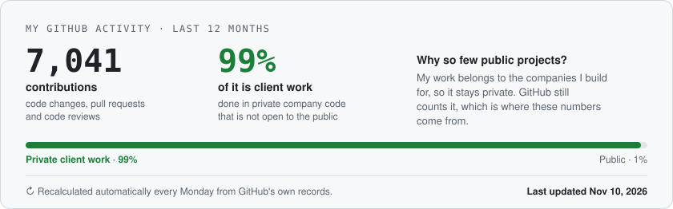

<div align="center">


<a href="https://git.io/typing-svg">
  <picture>
    <source media="(prefers-color-scheme: dark)" srcset="https://readme-typing-svg.demolab.com?font=Fira+Code&weight=600&size=22&duration=4000&pause=1000&color=3FB950&center=true&vCenter=true&multiline=true&repeat=true&width=800&height=100&lines=Senior+Forward+Deployed+Engineer+%26+Solutions+Architect;Building+AI+Agents%2C+Web+%26+Web3+Systems;Generative+AI+%7C+FinTech+%7C+HealthTech+%7C+Maps+%7C+Crypto" />
    
  </picture>
</a>

<br/>

<a href="https://linkedin.com/in/umarfarooqaslam"></a>&nbsp;
<a href="https://x.com/umimehar_ai"></a>&nbsp;
<a href="https://stackoverflow.com/users/5650793/umar-farooq-aslam"></a>&nbsp;
<a href="mailto:meher.umi@gmail.com"></a>

<br/>

<a href="https://www.linkedin.com/in/umarfarooqaslam/details/certifications/"></a>

</div>

---

### About me

**Senior forward deployed engineer** in Toronto with 10+ years across fintech, web3, maps and healthtech. I build AI agents and the full stack around them: the APIs, auth, data, evals and the boring parts that decide whether it still works on day 90.

<a href=".github/workflows/receipts.yml">
  <picture>
    <source media="(prefers-color-scheme: dark)" srcset="assets/receipts-dark.svg" />
    
  </picture>
</a>

---

### Production log

```diff
@@ 2026 @@
+ Delo (Deloitte)    AI bookkeeping and compliance platform. NetSuite integration, Auth0 then
+                    Cognito migration, hash chained audit trail. 191 merged PRs across 13 repos
+ Reggie             Founding engineer. Empty repo to a working compliance app in 3 weeks:
+                    FastAPI, Postgres row level security, React, then templates for the next apps
+ GTAA               Architecture review of Pearson Airport Work Authorization before rollout

@@ 2025 @@
+ Berachain          Canonical token bridge on LayerZero, live for mainnet launch
+ Google Maps        3D immersive retail demo on Photorealistic 3D Tiles and Cesium
+ Heron Finance      Private markets allocation engine and investor dashboards
+ Hibachi            Crypto trading UI on TradingView, market selector, order placement

@@ 2021 to 2024 @@
+ Coinbase           Web wallet modernization, Onchain Summer 2, Farcaster Frames in Base
+ ICONIQ Capital     Tools for teams managing family office and UHNW assets
+ Elbe AI            M&A due diligence workflows on Google Document AI
+ Jimini Health      First version of the React Native app and Fastify services
+ Cognito Health     NestJS backend and admin portal under HIPAA and PIPEDA
+ Sudoswap           NFT trading UI with batched multicall transactions
+ LavaPay            Microservices and microfrontends from day one, hired the team

@@ 2018 to 2021 @@
+ Global Villages    First engineer, web marketplace MVP in five months
+ Mart SA            Grocery platform in Saudi Arabia, promoted to lead a team of five
```

---

### How I work

- Start with a lean monolith; split into services when the team or the load asks for it.
- Agents get tools, evals and a clear point where they stop and ask a human.
- Ship behind flags, watch the logs, write down the decision.

---

### Tech I work with

<p align="center">
  
  
  
  
  
  
  
  
  
  
  
  
  
  
  
</p>

---

### Activity

<div align="center">
  <picture>
    <source media="(prefers-color-scheme: dark)" srcset="https://streak-stats.demolab.com/?user=umimehar&hide_border=true&background=00000000&stroke=30363D&ring=3FB950&fire=3FB950&currStreakNum=E6EDF3&sideNums=E6EDF3&currStreakLabel=3FB950&sideLabels=8B949E&dates=8B949E" />
    
  </picture>

  <br/><br/>

  
</div>


